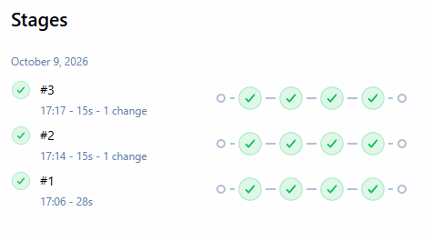
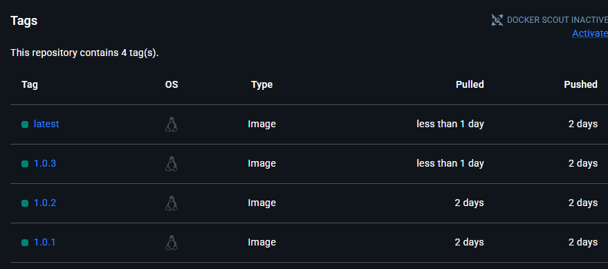

# DevOps CI/CD Demo

A small FastAPI service containerised with Docker and built and published
automatically by a Jenkins pipeline.

## Architecture

```
GitHub push -> Jenkins (SCM polling) -> docker build -> Docker Hub
```

## Tech stack

- FastAPI (Python)
- Docker and Docker Compose
- Jenkins (running in a container, declarative pipeline)
- Docker Hub as the image registry

## How the pipeline works

1. Jenkins polls this repository every ~2 minutes.
2. On a new commit, it builds the image and tags it `1.0.<build number>`
   and `latest`.
3. It logs in to Docker Hub using credentials stored in Jenkins (never in
   the repo) and pushes both tags.

Pipeline definition: [`Jenkinsfile`](Jenkinsfile)

## Run it locally

```
docker compose up --build
```

Then open http://localhost:8080

## Run Jenkins locally

```
cd jenkins
docker compose up -d
```

Jenkins is available at http://localhost:8081. You then need to:

1. Add a Docker Hub access token as a "Username with password" credential
   with ID `dockerhub-creds`.
2. Create a Pipeline job using "Pipeline script from SCM" that points to
   this repository.

## Design decisions

- **Polling instead of webhooks:** Jenkins runs on localhost and isn't
  reachable from GitHub. In production, a webhook would give instant
  triggers.
- **Versioned tags:** each build gets a unique tag, so any image can be
  traced back to a specific pipeline run.
- **Secrets:** credentials are injected at runtime with `withCredentials`
  and masked in logs.

## Screenshots

### Jenkins pipeline runs


### Versioned images on Docker Hub
