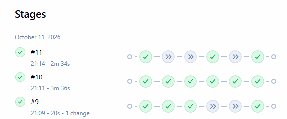
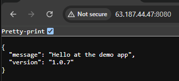

# DevOps CI/CD Demo

A small FastAPI service containerised with Docker and built, published and
deployed automatically by a Jenkins pipeline. The AWS infrastructure is
created and destroyed with Terraform from the same pipeline.

## Architecture

```
GitHub push -> Jenkins (SCM polling) -> docker build -> Docker Hub
                                     -> Terraform (EC2, state in S3)
                                     -> deploy over SSH (docker compose)
```

## Tech stack

- FastAPI (Python)
- Docker and Docker Compose
- Jenkins (running in a container, declarative pipeline)
- Docker Hub as the image registry
- Terraform for infrastructure as code
- AWS: EC2 for the server, S3 for Terraform state, IAM for access control

## How the pipeline works

The pipeline is controlled by an `ACTION` parameter:

| ACTION | What runs |
|---|---|
| `build-only` (default, used by polling) | Build and push the image |
| `deploy` | Build, push, provision EC2 with Terraform, deploy with Docker Compose |
| `destroy` | Tear down the EC2 infrastructure with Terraform |

1. Jenkins polls this repository every ~2 minutes.
2. Each build tags the image `1.0.<build number>` and `latest` and pushes both to Docker Hub.
3. On `deploy`, Terraform creates a `t3.micro` EC2 instance. Its state is stored in an S3 bucket with locking, so every pipeline run shares the same record.
4. Jenkins reads the server's IP from the Terraform output, waits for the boot script to finish, copies `deploy/compose.yaml` over SSH and starts the new image tag.
5. `destroy` removes the infrastructure to keep AWS costs near zero.

Pipeline definition: [`Jenkinsfile`](Jenkinsfile)

## Repository layout

| Path | Purpose |
|---|---|
| `app.py`, `Dockerfile`, `compose.yaml` | The application and its local container setup |
| `Jenkinsfile` | The CI/CD pipeline |
| `jenkins/` | Jenkins container image (Docker CLI, SSH client and Terraform included) |
| `deploy/compose.yaml` | Compose file that runs the published image on the server |
| `terraform/bootstrap/` | One-time creation of the S3 bucket for Terraform state |
| `terraform/ec2/` | EC2 instance, security group and key pair |

## Run it locally

```
docker compose up --build
```

Then open http://localhost:8080

## Run Jenkins locally

```
cd jenkins
docker compose up -d
```

Jenkins is available at http://localhost:8081. You then need to:

1. Install the SSH Agent plugin.
2. Add the credentials listed below.
3. Create a Pipeline job using "Pipeline script from SCM" that points to
   this repository.
4. Use "Build with Parameters" to run `deploy` or `destroy`.

## Jenkins credentials

| ID | Type | Purpose |
|---|---|---|
| `dockerhub-creds` | Username with password | Push images (Docker Hub access token) |
| `ec2-ssh-key` | SSH private key | Log in to the EC2 server |
| `aws-access-key-id` | Secret text | AWS access for Terraform |
| `aws-secret-access-key` | Secret text | AWS access for Terraform |
| `ec2-public-key` | Secret file | Public key installed on the instance |

The AWS credentials belong to a dedicated IAM user limited to EC2 and the state bucket.

## Design decisions

- **Polling instead of webhooks:** Jenkins runs on localhost and isn't
  reachable from GitHub. In production, a webhook would give instant
  triggers.
- **Versioned tags:** each build gets a unique tag, so any image can be
  traced back to a specific pipeline run.
- **Secrets:** credentials are injected at runtime with `withCredentials`
  and masked in logs.
- **Safe default action:** polled pushes only build and push. Provisioning AWS resources needs a deliberate `deploy` run, so a commit can't create a billable server by accident.
- **Remote state in S3:** the `terraform/bootstrap` folder creates the bucket once. The `terraform/ec2` folder stores its state there with encryption and locking.
- **Least-privilege IAM:** Jenkins uses its own IAM user instead of admin keys.
- **Infrastructure as code:** the server is created and destroyed by the pipeline, not by hand.
- **Restricted network access:** the security group only allows SSH and the app port from the IP address that ran the pipeline.

## Screenshots

### Pipeline runs: build-only, deploy and destroy


### Versioned images on Docker Hub


### Live app on AWS EC2

